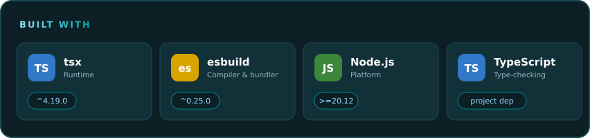

<div align="center">


<h1>SudoType</h1>

<p><b>Zero-config TypeScript toolchain for any Environment.</b><br>
Run, build, scaffold and type-check TypeScript with a single command.</p>

<p>
  
  
  
  
  
  
</p>

<p>
  <a href="https://github.com/arraynothere/sudotype"></a>
  <a href="https://www.npmjs.com/package/sudotype"></a>
  <a href="https://github.com/arraynothere/sudotype/issues"></a>
</p>

<p>
  <a href="#installation">Installation</a> ·
  <a href="#quick-start">Quick Start</a> ·
  <a href="#commands">Commands</a> ·
  <a href="#templates">Templates</a> ·
  <a href="#project-structure">Structure</a> ·
  <a href="#troubleshooting">Troubleshooting</a> ·
  <a href="#windows">Windows</a> ·
  <a href="#faq">FAQ</a>
</p>



</div>

<br>

<h2 id="overview">Overview</h2>

<p>
Setting up TypeScript on a phone usually means writing a <code>tsconfig.json</code> by hand, installing a compiler, and fixing native binaries that do not match the device. SudoType wraps that into one CLI. It uses <a href="https://github.com/privatenumber/tsx">tsx</a> to run files and <a href="https://esbuild.github.io">esbuild</a> to compile them. esbuild ships native <code>android-arm64</code> binaries that work in Termux, and tsx runs on top of it.
</p>

<table>
  <tr>
    <td width="50%"><b>Run without a build step</b><br>Execute <code>.ts</code> files directly, with watch mode.</td>
    <td width="50%"><b>Project scaffolding</b><br>Start from Express, Discord bot, CLI or basic templates.</td>
  </tr>
  <tr>
    <td width="50%"><b>Fast compile</b><br>Bundle to a single JavaScript file with esbuild.</td>
    <td width="50%"><b>Environment check</b><br><code>sudotype doctor</code> reports what is missing.</td>
  </tr>
</table>

<h2 id="requirements">Requirements</h2>

<ul>
  <li>Node.js <code>20.12</code> or newer (the <code>discord</code> template uses <code>process.loadEnvFile()</code>)</li>
  <li>Termux (Android, ARM64), or any Linux / macOS / Windows machine with Node.js</li>
  <li><code>git</code> (optional, used by <code>sudotype init</code>)</li>
</ul>

<h3>Supported platforms</h3>

SudoType is plain JavaScript on top of esbuild and tsx, so it runs anywhere Node.js 20.12+ and esbuild run.

<table>
  <thead>
    <tr><th align="left">Platform</th><th align="left">Status</th></tr>
  </thead>
  <tbody>
    <tr><td>Termux (Android, ARM64)</td><td>Primary target</td></tr>
    <tr><td>Linux (x64, ARM64), WSL, Docker, Raspberry Pi, Codespaces</td><td>Supported</td></tr>
    <tr><td>Linux on Android (proot-distro, UserLAnd, Andronix)</td><td>Supported</td></tr>
    <tr><td>macOS (Intel, Apple Silicon)</td><td>Supported</td></tr>
    <tr><td>Windows (x64, ARM64)</td><td>Supported (see <a href="#windows">Windows notes</a>)</td></tr>
    <tr><td>FreeBSD, OpenBSD, ChromeOS (Crostini)</td><td>Should work, not tested</td></tr>
    <tr><td>iOS (iSH, a-Shell)</td><td>Not supported</td></tr>
  </tbody>
</table>

CI runs the test suite on Ubuntu, macOS and Windows with Node.js 20, 22 and 24.

<h2 id="installation">Installation</h2>

**Termux (Android)**

```sh
pkg update && pkg install nodejs git
npm install -g sudotype
```

**Linux / macOS / Windows**

```sh
npm install -g sudotype
```

Or run it without installing:

```sh
npx sudotype doctor
```

Update or remove it:

```sh
npm update -g sudotype
npm uninstall -g sudotype
```

Verify the setup:

```sh
sudotype --version
sudotype doctor
```

<h2 id="why">Why SudoType?</h2>

<p>
You can call <code>tsx</code> and <code>esbuild</code> directly, but you still have to wire up the <code>tsconfig.json</code>, the build flags, the project layout and the environment checks yourself. SudoType puts those behind one command and ships ready-made templates, so a fresh phone goes from zero to a running TypeScript project in a few commands.
</p>

<h2 id="quick-start">Quick Start</h2>

**1. Run a file**

```sh
echo 'console.log("Hello from SudoType");' > hello.ts
sudotype run hello.ts
```

**2. Create a project**

```sh
sudotype init my-api --template express --install
cd my-api
```

**3. Develop, check and build**

```sh
sudotype watch src/index.ts     # restart on change
sudotype check                  # type-check
sudotype build src/index.ts     # output: dist/index.js
```

<h2 id="commands">Commands</h2>

<table>
  <thead>
    <tr><th align="left">Command</th><th align="left">Description</th></tr>
  </thead>
  <tbody>
    <tr><td><code>sudotype run &lt;file.ts&gt; [args]</code></td><td>Run a TypeScript file</td></tr>
    <tr><td><code>sudotype watch &lt;file.ts&gt;</code></td><td>Run and restart on file changes</td></tr>
    <tr><td><code>sudotype build [entry]</code></td><td>Bundle to JavaScript with esbuild</td></tr>
    <tr><td><code>sudotype init [name]</code></td><td>Scaffold a new project</td></tr>
    <tr><td><code>sudotype check</code></td><td>Type-check with <code>tsc --noEmit</code></td></tr>
    <tr><td><code>sudotype tsconfig</code></td><td>Write a ready-to-use <code>tsconfig.json</code></td></tr>
    <tr><td><code>sudotype doctor</code></td><td>Diagnose the environment</td></tr>
  </tbody>
</table>

<h3>run / watch</h3>

Arguments after the file name are passed to your program.

```sh
sudotype run src/index.ts --port 8080
sudotype watch src/index.ts
```

<h3>build</h3>

The entry file defaults to `src/index.ts`. Dependencies stay external unless `--bundle-deps` is set.

```sh
sudotype build                              # src/index.ts -> dist/index.js
sudotype build src/cli.ts --minify
sudotype build src/index.ts -f cjs -o out/app.cjs --sourcemap
sudotype build src/index.ts --bundle-deps   # single self-contained file
```

<table>
  <thead>
    <tr><th align="left">Option</th><th align="left">Default</th><th align="left">Description</th></tr>
  </thead>
  <tbody>
    <tr><td><code>-o, --out &lt;file&gt;</code></td><td><code>dist/&lt;name&gt;.js</code> (<code>.cjs</code> / <code>.mjs</code> when the format differs from <code>"type"</code>)</td><td>Output file</td></tr>
    <tr><td><code>-f, --format &lt;esm|cjs&gt;</code></td><td>from <code>package.json</code> <code>"type"</code></td><td>Output module format</td></tr>
    <tr><td><code>--target &lt;target&gt;</code></td><td><code>node20</code></td><td>esbuild target</td></tr>
    <tr><td><code>--minify</code></td><td>off</td><td>Minify the output</td></tr>
    <tr><td><code>--sourcemap</code></td><td>off</td><td>Emit a source map</td></tr>
    <tr><td><code>--bundle-deps</code></td><td>off</td><td>Bundle <code>node_modules</code> into the output</td></tr>
  </tbody>
</table>

<h3>init</h3>

Run it without arguments for an interactive prompt, or pass everything as flags.

```sh
sudotype init                                   # interactive
sudotype init my-bot -t discord --install       # flags only
sudotype init my-cli -t cli --no-git
```

<table>
  <thead>
    <tr><th align="left">Option</th><th align="left">Description</th></tr>
  </thead>
  <tbody>
    <tr><td><code>-t, --template &lt;name&gt;</code></td><td><code>basic</code>, <code>express</code>, <code>discord</code> or <code>cli</code></td></tr>
    <tr><td><code>-i, --install</code></td><td>Run <code>npm install</code> after scaffolding</td></tr>
    <tr><td><code>--no-git</code></td><td>Skip <code>git init</code></td></tr>
  </tbody>
</table>

<h3>check / tsconfig / doctor</h3>

```sh
sudotype check                  # requires typescript in the project
sudotype tsconfig               # fails if tsconfig.json exists
sudotype tsconfig --force       # overwrite
sudotype doctor                 # exit code 1 if a problem is found
```

<h2 id="templates">Templates</h2>

<table>
  <thead>
    <tr><th align="left">Template</th><th align="left">Description</th><th align="left">Extra dependencies</th></tr>
  </thead>
  <tbody>
    <tr><td><code>basic</code></td><td>Minimal TypeScript project</td><td>none</td></tr>
    <tr><td><code>express</code></td><td>REST API server listening on <code>PORT</code> (default 3000)</td><td><code>express</code></td></tr>
    <tr><td><code>discord</code></td><td>Discord bot with a <code>/ping</code> slash command</td><td><code>discord.js</code> v14</td></tr>
    <tr><td><code>cli</code></td><td>Command-line app using <code>node:util</code> <code>parseArgs</code></td><td>none</td></tr>
  </tbody>
</table>

Every generated project includes these scripts, so the global `sudotype` command must be installed:

```sh
npm start         # sudotype run src/index.ts
npm run dev       # sudotype watch src/index.ts
npm run build     # sudotype build src/index.ts --minify
npm run check     # sudotype check
```

The Discord template reads `DISCORD_TOKEN` and `CLIENT_ID` from `.env`:

```sh
cp .env.example .env            # fill in the values
sudotype run src/deploy-commands.ts
sudotype run src/index.ts
```

<h2 id="project-structure">Project Structure</h2>

<h3>Generated project</h3>

```text
my-api/
├── src/
│   └── index.ts
├── .env.example        (express, discord)
├── .gitignore
├── package.json
├── README.md
└── tsconfig.json
```

The `discord` template also contains `src/deploy-commands.ts`.

<h3>This repository</h3>

```text
sudotype/
├── bin/
│   └── sudotype.js         CLI entry point
├── src/
│   ├── cli.js              command dispatcher
│   ├── utils.js            shared helpers
│   └── commands/           run, build, init, check, tsconfig, doctor
├── templates/              basic, express, discord, cli
├── test/
│   └── smoke.test.js
├── assets/                 README badges and graphics
├── CHANGELOG.md
├── CONTRIBUTING.md
├── icon/                   project icons
├── tsconfig.base.json
└── package.json
```

<h2 id="troubleshooting">Troubleshooting</h2>

<details>
<summary><b>esbuild fails to start</b></summary>
<br>

```sh
pkg upgrade
npm install -g sudotype --force
sudotype doctor
```

</details>

<details>
<summary><b>Node.js version is too old</b></summary>
<br>

```sh
pkg upgrade nodejs
node --version      # must be 20.12 or newer
```

</details>

<details>
<summary><b><code>sudotype check</code> says TypeScript is not installed</b></summary>
<br>

`check` uses the TypeScript version of the current project:

```sh
npm install -D typescript @types/node
```

</details>

<details>
<summary><b>The Discord template says <code>Missing DISCORD_TOKEN</code> but my <code>.env</code> is filled in</b></summary>
<br>

`process.loadEnvFile()` needs Node.js 20.12 or newer. Check with `node --version` and upgrade if needed.

</details>

<details>
<summary><b><code>command not found: sudotype</code></b></summary>
<br>

```sh
npm config get prefix           # the bin folder must be in PATH
npm install -g sudotype
```

</details>

<h2 id="windows">Windows notes</h2>

<ul>
  <li>Use PowerShell, Command Prompt or WSL. All commands work the same way.</li>
  <li><code>sudotype init --install</code> runs <code>npm.cmd</code> through the shell, so Node.js must be on your <code>PATH</code>.</li>
  <li>Press <code>Ctrl+C</code> to stop <code>run</code> and <code>watch</code>.</li>
</ul>

<h2 id="faq">FAQ</h2>

<details>
<summary><b>Why not Bun?</b></summary>
<br>
Bun does not run natively on Termux because it needs glibc. tsx and esbuild work on Android (Bionic) without extra layers.
</details>

<details>
<summary><b>Does it work outside Termux?</b></summary>
<br>
Yes. SudoType runs on any system with Node.js 20.12 or newer, including Linux, macOS and Windows. See <a href="#requirements">Supported platforms</a>.
</details>

<h2 id="contributing">Contributing</h2>

```sh
git clone https://github.com/arraynothere/sudotype.git
cd sudotype
npm install
npm test
node bin/sudotype.js doctor
```

Pull requests and issues are welcome at [github.com/arraynothere/sudotype](https://github.com/arraynothere/sudotype). Maintainers: see [CONTRIBUTING.md](CONTRIBUTING.md) for the release process.

<h2 id="changelog">Changelog</h2>

See [CHANGELOG.md](CHANGELOG.md) for release notes.

<h2 id="license">License</h2>

Released under the [MIT License](LICENSE).

<div align="center">
  <br>
  <sub>Made by <a href="https://github.com/arraynothere">Array</a></sub>
</div>
